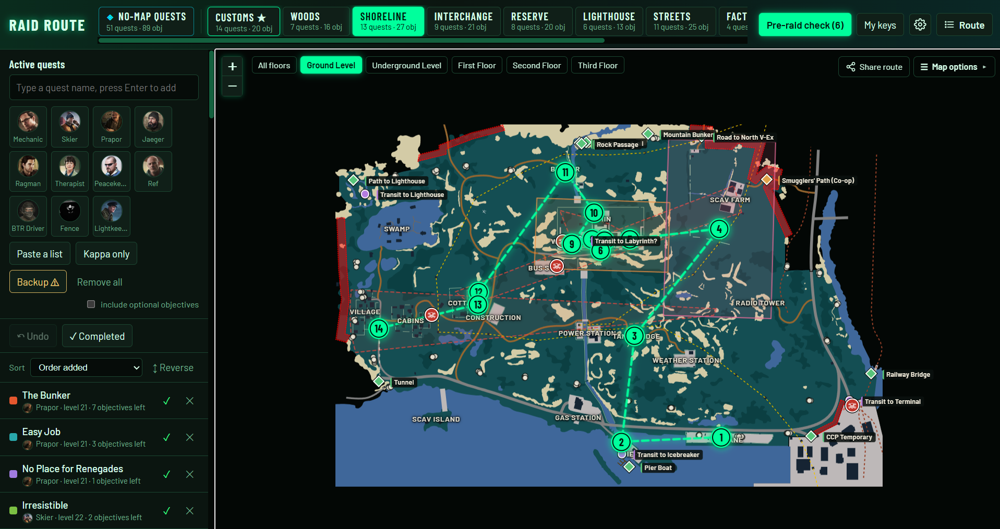

# Tarkov-Waypoint

An interactive map and routing utility designed for *Escape from Tarkov*. Built to take the guesswork out of raid preparation by seamlessly linking active quests, required keys, and custom paths into a single routing system.

🔗 [Access the Live App Here!](https://tarkov-waypoint.pages.dev/)

## ✨ Features

* 🎯 **Dynamic Quest Routing**: Plot multi-objective routes across maps based on your active task list.
* 🔑 **Key & Door Management**: Match locked rooms to the keys in your inventory so you never miss an objective or loot spot.
* 🗺️ **Interactive Maps**: Smooth navigation and custom visual markers for fast raid planning.
* ⚡ **Companion Friendly**: Optimized for second-monitor setups or tablet use during raids.
