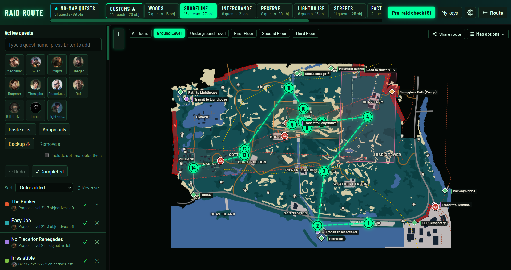

# Tarkov-Waypoint

An interactive map and routing utility designed for *Escape from Tarkov*. Built to take the guesswork out of raid preparation by seamlessly linking active quests, required keys, and custom paths into a single routing system.

🔗 [Access the Live App Here!](https://tarkov-waypoint.pages.dev/)

## ☕ Support the project

Tarkov-Waypoint is free, with no ads. If it saves you a raid or two, you can help keep it going:

## ✨ Features

* 🎯 **Dynamic Quest Routing**: Plot multi-objective routes across maps based on your active task list.
* 🔑 **Key & Door Management**: Match locked rooms to the keys in your inventory so you never miss an objective or loot spot.
* 🗺️ **Interactive Maps**: Smooth navigation and custom visual markers for fast raid planning.
* ✏️ **Custom Routes & Sharing**: Draw your own named routes and save a picture of the map to send to your squad.
* 👥 **Friends**: Sign in with Discord, add friends, and see their pins and quest progress.
* ⚡ **Companion Friendly**: Optimized for second-monitor setups or tablet use during raids.
* 🌐 **PvP and PvE**: Switch between modes, each with its own prices and progress.
* 🌍 **Multiple languages**: Pick your language in Settings.

## 🧰 Tools

* 🔫 **Gun builder**: Build guns, see stats and prices, and save your builds.
* 💰 **Flea prices, Meta ammo & Meta gear**: Look up prices and see the best ammo and gear.
* 🏠 **Hideout planner**: Track station levels and what your next upgrades need, with found-in-raid items marked and crafts for each item.
* 🔨 **Craft profit & Barter profit**: See which hideout crafts and trader barters pay off.
* ⏱️ **Generator timer**: Get a sound, notification and on-screen banner when your crafts finish, so the generator is not left running.
* 🏅 **Prestige tracker**: Track your road to the next prestige.
* 📈 **Skill leveling guide**: A step-by-step guide for Main game or Arena, plus what trains every skill.
* 🪖 **My PMC**: Set your level and trader levels once and every tool uses them.
* ⭐ **Kappa progress**: Track your Kappa quests and items.

## 💻 Desktop companion

A free Windows app that follows your game live: quests tick themselves, your map switches as you load in, and your raid timer runs. It reads only your game logs.

Source for the companion lives in [`companion`](https://github.com/g-hostproxy/Tarkov-Waypoint/tree/main/companion).

## 🙏 Credits

* Game data and prices from [tarkov.dev](https://tarkov.dev).
* Map art from [tarkov.dev SVG maps](https://github.com/the-hideout/tarkov-dev-svg-maps) (CC BY-NC-SA 4.0).
* Escape from Tarkov is a trademark of Battlestate Games. This project is a fan-made tool and is not affiliated with Battlestate Games.
